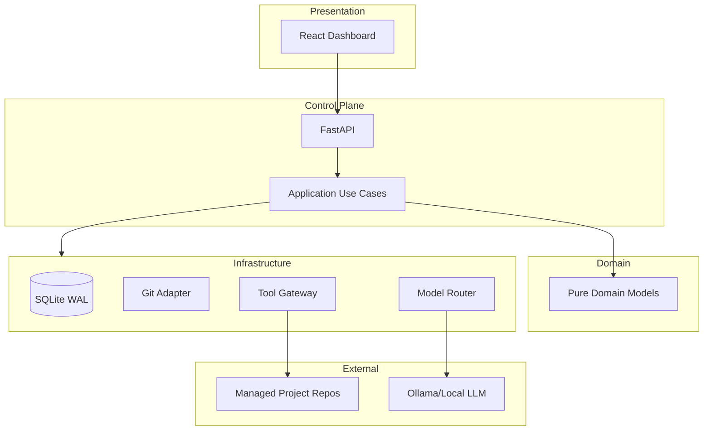

# FADE — Implementační plán platformy

Verze: 1.0 | Datum: 2026-07-14 | Stav: Milestone 0 implementován

## 1. Přehled

FADE je lokální autonomní AI platforma pro řízení samostatných softwarových projektů. Platforma poskytuje registry, analýzu, plánování, izolované workspace, agentní workflow, bezpečné tools, patching, testování, repair loop, evidence ledger a dashboard.

## 2. Architektura (zamčeno)

## 3. Milníky implementace

| Milník | Název | Klíčové deliverables | Závislosti |
|--------|-------|---------------------|------------|
| **M0** | Foundation & Architecture Lock | Repo struktura, health/doctor API, System Status UI, SQLite, testy | — |
| **M1** | Project Registry & Preflight | CRUD projektů, path safety, preflight pipeline, Add Project wizard | M0 |
| **M2** | Analysis & Project Profile | Symbol parsery, manifest discovery, inkrementální index, Explorer UI | M1 |
| **M3** | Durable Jobs & Evidence | DB queue, worker, job state machine, evidence chain, SSE timeline | M1 |
| **M4** | Planning & Model Router | Ollama adapter, context bundle, goal/plan workflows, Plan UI | M2, M3 |
| **M5** | Workspace, Tools & Patch | Git worktree, Tool Gateway, safe commands, Patch Engine, Diff UI | M3, M4 |
| **M6** | Verification & Repair | Verification matrix, parsers, gates, Debugger role, repair loop | M5 |
| **M7** | Guardian Hardening | Autonomy levels, secret store, network policy, approval flows | M5, M6 |
| **M8** | Real Project Pilots | NeuroString, TradePilot, CRATE end-to-end validace | M7 |
| **M9** | Production Candidate | Performance budgets, backup/restore, release packaging, runbooks | M8 |

## 4. Milestone 0 — dokončeno

### Dodané komponenty

- **Repository**: `apps/api`, `apps/web`, `packages/domain|application|infrastructure`, `migrations`, `tests`, `scripts`
- **Toolchain**: uv (Python 3.12), pnpm (Node 20+)
- **API**: `/api/v1/system/health`, `/api/v1/system/doctor`, correlation ID, error envelope
- **Domain**: `ProjectId`, `JobId`, `RiskLevel`, `AutonomyLevel`, `ErrorCode`
- **Persistence**: SQLite WAL, Alembic, `projects` tabulka
- **Frontend**: Layout, navigace, System Status stránka s loading/error states
- **Testy**: domain unit, architecture boundary, API integration, migration, frontend component
- **Skripty**: `dev.sh`, `test.sh`, `doctor.sh`

### Acceptance criteria — splněno

- [x] Clean install na Ubuntu/WSL2
- [x] Domain neimportuje framework/infrastructure
- [x] API testy pro success i failure
- [x] Health reportuje DB stav a capability flags
- [x] Logs neexponují secrets
- [x] Fresh DB upgraduje na head
- [x] Frontend production build
- [x] UI nehlásí plánované capabilities jako dostupné

## 5. Další krok — Milestone 1

### M1-E1: Project CRUD
- Domain entity `Project` + repository port
- SQLAlchemy repository implementace
- API: list, get, register, patch metadata, archive
- Idempotentní registrace

### M1-E2: Source & path safety
- Allowed roots konfigurace
- Canonical path + symlink containment
- Git source validace

### M1-E3: Preflight pipeline
- File count/size inventory
- Git revision/dirty/branch
- Manifest detection
- Sensitive file name scan

### M1-E4: UI
- Add Project wizard
- Portfolio s project cards

**Exit gate M1**: Validní lokální Git projekt dosáhne READY; malicious path fixture je odmítnut; originální projekt zůstane nezměněn.

## 6. Rizika a předpoklady

| Riziko | Mitigace |
|--------|----------|
| 8 GB RAM limit pro modely | Resource-aware scheduler, lokální model jako default |
| SQLite concurrency | WAL mode, single-writer pattern |
| Bezpečnost managed projektů | Tool Gateway, path policy, isolated worktrees |
| Scope creep | Jeden milník najednou, ADR pro odchylky |

## 7. Technický dluh (M0)

- Package skeletony (`agent_runtime`, `tool_gateway`, atd.) zatím neexistují — vytvoří se v příslušných milnících
- Worker je placeholder — implementace v M3
- Capabilities v health endpointu jsou všechny `false` — správné pro M0
